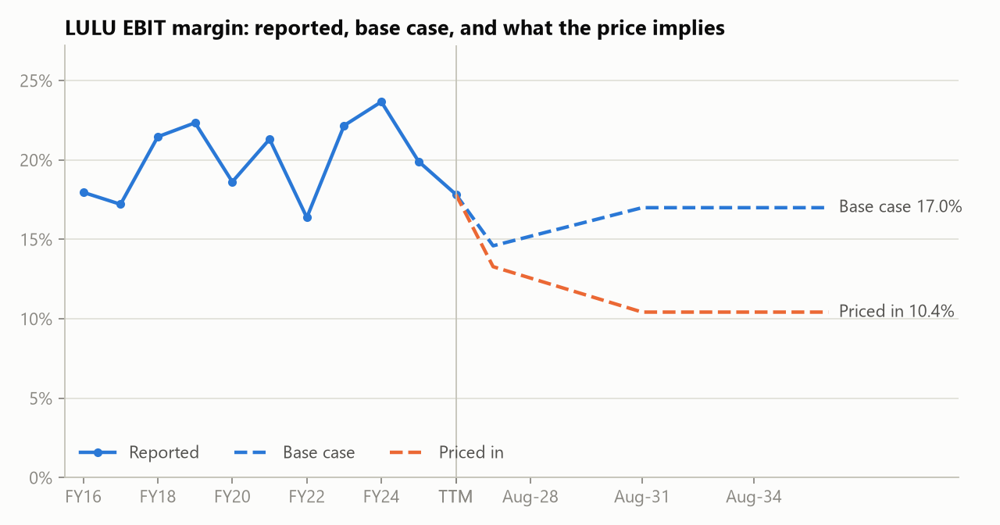
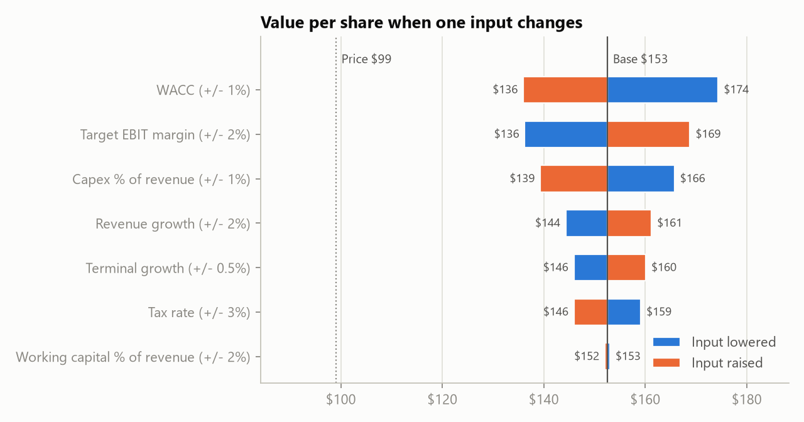

# lululemon (LULU): what's priced in?

Aasa Singh | October 23, 2026 | Share price $99.01

## Summary

- At $99, the market is pricing lululemon as if its operating margin drops to about 10% and stays there. That would be lower than any year in the last decade. The lowest was 16.4% in FY22.
- My base case has margins recover partway, to 17%, and puts value at **$153 per share, 54% above the current price**.
- The stock only looks fairly priced if margins fall to about 10% with no revenue growth ($89). If I cut margins to 14% for good and raise the discount rate to 11%, value is still $113.

## The business today

Revenue grew from $2.3B in FY16 to $11.1B in FY25. Growth has now stalled. Revenue over the twelve months to August 2026 was up 1.7%, and the EBIT margin has fallen from a peak of 23.7% in FY24 to 17.8%.

The balance sheet is clean. There is no funded debt and $1.39B of cash. Over the last twelve months the business generated $1.35B of free cash flow to the firm and spent $1.16B on buybacks. The share count has fallen from 137M in FY16 to 110.6M.

At $99 the market cap is $10.9B and enterprise value is $9.6B. That is 4.8x trailing EBIT, a free cash flow yield of about 14% on enterprise value.

## What the price implies

I ran the model in reverse. Holding everything else at my base case, I solved for the one input that makes value per share equal to $99.01.

| Input | My base case | Implied by $99 |
|---|---|---|
| Target EBIT margin | 17.0% | 10.4% |
| Revenue growth (start of fade) | 3.0% | -13.0% |
| 10-year revenue CAGR (growth case) | 1.7% | -4.8% |

Either way, the price assumes a much worse business than lululemon has ever been. The growth version means revenue shrinks almost 5% a year for ten years.

## Base case

- **Revenue:** -7% next year, based on the FY26 guidance midpoint of $10.43B, which implies a weak second half. From year two, growth is about 3%: Americas roughly flat, while China and the rest of international (about 30% of sales) grow at low double digits. Growth fades to 2.5% by year ten.
- **Margin:** starts at 14%, in line with guidance for a weak H2 (tariffs, markdowns), and recovers to 17% over five years. That is below the 20% to 24% of FY21 to FY24 because tariffs look permanent and pricing power has weakened.
- **Reinvestment:** capex 5.5% of revenue, D&A 4.5%, working capital 7% (trailing 10.1% is inflated by excess inventory).
- **Discount rate:** WACC 9.85%. Risk-free 5.12%, beta 1.05, equity risk premium 4.5%. Beta from five years of monthly returns is 0.91; I used a higher apparel peer level because brand risk looks higher than the market data suggests.

| | $B |
|---|---|
| PV of 10-year free cash flow | 7.72 |
| PV of terminal value | 7.76 |
| Enterprise value | 15.47 |
| Plus net cash | 1.39 |
| Equity value | 16.86 |
| Value per share (110.6M shares) | $152.53 |

## Stress tests

| Case | Value per share | vs. price |
|---|---|---|
| Bull: growth +4 pts, margin 20% | $198 | +100% |
| Base | $153 | +54% |
| Margin stays at 14% | $128 | +29% |
| WACC 11% | $134 | +35% |
| Bear: growth -4 pts, margin 14% | $115 | +17% |
| Margin 14% and WACC 11% | $113 | +14% |
| Margin 12%, no growth | $104 | +5% |
| Margin 10%, no growth | $89 | -10% |

The discount rate and the target margin move value the most. No single input changed by a reasonable amount gets value near $99.

## Where I could be wrong

- **Margins keep falling.** If tariffs, markdowns and competition from newer athletic brands push margins toward 12%, most of the upside is gone. The FY22 low of 16.4% was a one-year dip. This could be a lasting reset.
- **Americas gets worse.** My base case has the Americas flat from year two. A multi-year decline there would offset the growth from international.
- **Half the value is terminal value.** It is 50% of enterprise value, so the result depends on lululemon still being a healthy business in ten years.
- **Model simplifications.** Cash flows are discounted from August 2026, not today. Default assumptions are only a starting point. I set every input above myself.

## What would change my view

- EBIT margin below 12% for two quarters in a row.
- Americas revenue declines getting faster rather than leveling off.
- International growth slowing to single digits.

## Conclusion

At $99, the market is pricing in a worse future for lululemon than its own history suggests. My base case gives $153. Even my stressed cases mostly stay above the current price. The main risk is that the margin decline is permanent, so the next few quarters of margin results matter more than anything else in this model.

*Student research project, not investment advice. Model, data and assumptions: github.com/aasasingh/dcf-engine*
